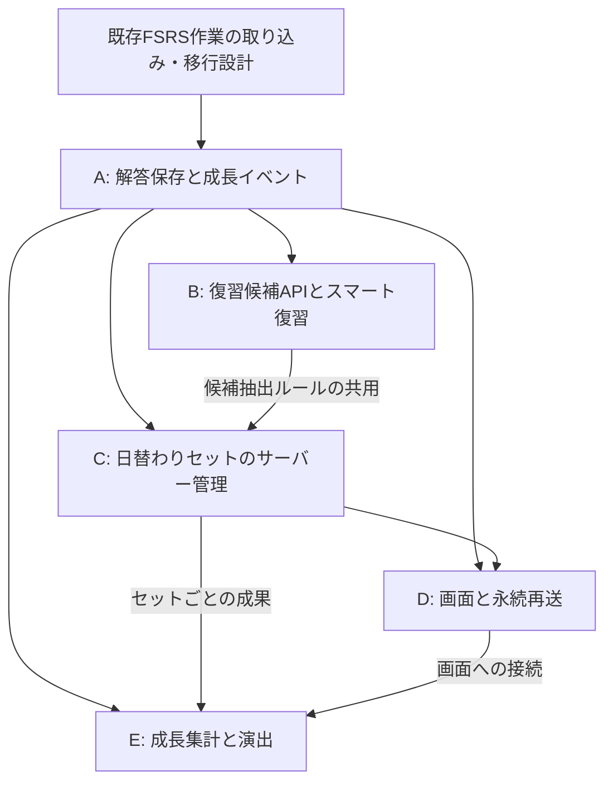

# 学習体験刷新 — Issue 要件定義（確定・起票済み）

この文書は `iQbe_codex_handoff_learning_experience.md` を、実装担当者が会話履歴なしで計画できる5件のIssueへ整理した要件定義。2026-11-16にユーザーが全体の要件と起票方針を確認し、既存 #308 の更新と新規 #314〜#317 の作成を完了した。

## スマート復習の追加要件（確定・GitHub反映済み）

ユーザーの訂正により、旧Q16の「最大20問を一巡で終了」を置き換えた。過去の復習残しと当日中に期限を迎える問題を全問対象とし、全問正解するまで解き直す。将来の押した位置の表示では、全モード共通の「ユーザー・問題・JST日付ごとの最初の解答」が正解だった場合の有効な位置だけを使う。同日の2回目以降は除外し、翌日の初回正解は対象に戻る。

Q17〜Q20の回答に基づき、#315の進行仕様、#314の記録・初回識別、#308の解き直しの記録、#316の画面・再送、#317の後続集計要件を改訂した。押した位置の表示自体は後続とし、今回は識別情報を保存するところまでを要件に含む。

ユーザーの「GitHubに反映してください」という指示を受け、既存の #314・#315・#308・#316・#317 を改訂本文で更新した。更新後に5件を再取得し、タイトル・本文の一致を確認済み。

## 今回の依頼と資料の扱い

- 今回の成果物は Issue の要件定義。資料末尾の「PR #1 に着手」は、今回の実装指示として扱わない。
- 元資料の PR #1〜#10 はロードマップ上の通し番号であり、GitHub の Issue / PR 番号ではない。
- 資料の旧現状・旧案より、今回確認した実装上の事実とユーザーの回答を優先する。
- 実装コード・テストコードの追加や変更、本番 DB 操作は今回の範囲に含めない。
- 実装時も `AGENTS.md` のテスト作成方針を守る。受入条件の記載は、エージェントによるテストコードの作成許可を意味しない。

## 確定した要件

| ID  | 判断                                                                                                                                                                                                       | 根拠                   |
| --- | ---------------------------------------------------------------------------------------------------------------------------------------------------------------------------------------------------------- | ---------------------- |
| D1  | 初期からFSRSを採用し、日替わりセットとスマート復習は全対象に正解するまで解き直す。当日の完了と定着推定を区別する                                                                                           | Q1・Q17回答            |
| D2  | 定着推定は評価時点から30日後の想起確率90%以上、かつ長期復習段階とする                                                                                                                                      | Q1 回答                |
| D3  | 初回リリースはオンライン学習。通信失敗時の再送の重複防止と別端末の進捗共有は必須。オフライン学習は後続 Issue                                                                                               | Q2 回答                |
| D4  | 日替わりセットはログインユーザーの全所有問題を対象とする。問題集・タグでの絞り込みは初期対象外                                                                                                             | Q3 回答                |
| D5  | 初回リリースは最大5問固定。問題数のユーザー設定は後続                                                                                                                                                      | Q4 回答                |
| D6  | 期限到来の復習3問＋未学習2問を基本とし、不足分はもう片方で補う。復習は期限が古い順、未学習は無作為に選ぶ。期限前の学習済み問題では補わない                                                                 | Q5 回答                |
| D7  | JSTの日付が変わったら当日のセットへ切り替える。前日のセットへの新規解答は受け付けず、学習状態と復習期限は維持する。保存済み解答の再送は同じ結果を返す                                                      | Q6 回答                |
| D8  | 削除されたセット内の問題は補充せず対象外にする。残った問題の全問正解で完了し、全問対象外なら達成扱いにしない                                                                                               | Q7 回答                |
| D9  | 別端末の異なる解答IDはそれぞれ履歴・FSRSに反映し、サーバーの受け付け順に処理する。当日の問題完了は一度だけ成立し、後の不正解では取り消さない                                                               | Q8 回答                |
| D10 | 初正解はその問題への初めての正解。リベンジ成功は直前が不正解またはスルーで今回正解。復習成功は解答直前に復習期限が到来していた問題への正解。同日・自由演習も対象で、一つの解答に複数イベントが成立してよい | Q9 回答                |
| D11 | 過去履歴を時系列にFSRSへ通し、学習状態・期限・定着推定を引き継ぐ。過去の成長イベントは後付けせず、イベント集計の開始時点を表示する                                                                         | Q10 回答               |
| D12 | 初回の成長表示は期間内の解答回数・異なる問題数・リベンジ成功回数・復習成功回数と、現在の復習待ち問題数・定着推定問題数の6指標。定着推定の過去の推移は後続                                                  | Q11 回答               |
| D13 | 送信前の解答を端末に永続保存し、再読み込み・ブラウザ終了後も同じ解答IDで再送する。保存成功まで次の問題へ進まない                                                                                           | Q12 回答               |
| D14 | 候補0問ではセットを確定しない。同日中に候補が増えれば開始できる。一度1〜5問を確定した後は増やさない                                                                                                        | Q13 回答               |
| D15 | 問題削除時は既存同様に履歴・習熟状態を削除し、成長イベントも集計から除く。日替わりセットには対象外になった情報を残す                                                                                       | Q14 回答               |
| D16 | 成長画面は週を初期表示とし、JSTの暦日・日曜始まりの暦週・暦月を切り替える。現在値2指標と期間内4指標を分ける                                                                                                | Q15 回答               |
| D17 | スマート復習は過去の復習残しと当日中に期限を迎える全問を対象にし、全問正解まで解き直す。初回は当日の好きな時間に取り組め、解き直しは短期の待機を挟む。20問上限は設けない                                   | Q17回答（旧Q16を置換） |
| D18 | 将来の押した位置の直近・平均は当日初回に正解した有効な位置だけを対象とし、スマート復習と今日の5問の解き直しも履歴・FSRSには残す                                                                            | Q18・Q19回答           |
| D19 | 当日初回はユーザー・問題・JST日付ごとの最初の保存済み解答。自由演習も共通に数え、モード切替・中断再開・別端末でリセットしない。同日の2回目以降を集計から除き、翌日の初回で正解すれば対象になる             | Q20回答                |

用語は [GLOSSARY.md](../GLOSSARY.md) に記録する。

## 実装の基準点と現在地

調査対象の作業ブランチは `woodnx/issue14`、HEAD は `d53f14e`。未コミット作業が多数ある。以下の「作業中」は、マージ済み・DB適用済み・動作検証済みを意味しない。実装計画作成時には対象ブランチを改めて確認すること。

| 項目                                            | 現在地                                                                                                 | 主な参照先                                                                                                                                                                                  |
| ----------------------------------------------- | ------------------------------------------------------------------------------------------------------ | ------------------------------------------------------------------------------------------------------------------------------------------------------------------------------------------- |
| 履歴の独立ID・再送キー                          | コミット済み。`histories.id` と `(user_id, client_attempt_id)` 一意制約あり                            | `packages/backend/prisma/schema.prisma`、`packages/backend/prisma/migrations/20261106090244_change_schema_history/migration.sql`                                                            |
| 解答APIの再送                                   | `clientAttemptId` はUUID必須。同じ内容の再送は空の200、異なる内容の同じIDは409                         | `packages/backend/src/interfaces/controllers/Practice/schema.ts`、`packages/backend/src/applications/usecases/PracticeUseCase.ts`、`packages/backend/src/domains/History/HistoryServise.ts` |
| 保存待ち・再送画面                              | `mutateAsync` で成功を待ち、失敗時は同じIDで再送する。保留解答はメモリ上にあり、再読み込みでは失われる | `packages/frontend/src/features/practice/components/PracticeSceneChanger.tsx`                                                                                                               |
| 習熟状態の基本構造                              | 現在のHEADにテーブル・エンティティ・保存処理がある。演習APIには未接続                                  | `packages/backend/src/domains/UserQuizState/`、`packages/backend/src/interfaces/infra/UserQuizStateInfra.ts`                                                                                |
| FSRS                                            | 未コミット作業としてドメイン・サービス・アダプター・記憶情報の保存列がある。演習APIには未接続          | `docs/review_scheduler.md`、`packages/backend/src/applications/services/ReviewService.ts`、`packages/backend/src/interfaces/factories/createReviewService.ts`                               |
| 日替わりセット・期限到来の復習API・成長イベント | 未実装                                                                                                 | 元資料の提案を、今回の回答に基づいて具体化する                                                                                                                                              |
| 既存分析                                        | 解答履歴の件数・ランキング等は存在。定着推定・復習成功等は未実装                                       | `packages/backend/src/routes/analysis.ts`                                                                                                                                                   |
| Dexie                                           | 自由演習再開の `practiceSessions` のみ。日替わりセットや永続的な再送キューは未実装                     | `packages/frontend/src/plugins/db.ts`                                                                                                                                                       |

GitHub の既定ブランチ上の `PracticeUseCase.ts` でも既存の再送対応を確認した。ただし、作業ツリー全体がリモートの最新 main と一致することは意味しない。

### 押した位置の現行データ

- `histories.pressed_word` に押し位置を保存している。値は表示済み問題文のUTF-16コード単位数で、0は有効、-1/nullは位置不明。
- 現行履歴にはモード・復習回・当日初回の識別はない。モードや回は過去分を復元できないが、保存済みの日時・履歴IDから日別の最初の解答を判定できる範囲はある。
- 現行の中断/終了経路には正解でも一律-1を送る箇所がある。取得済み位置を保持する要件を #314/#316 に記載した。
- 現在の履歴取得APIに直近・平均の押し位置はなく、その表示は後続。今回の記録拡張を、6つの成長指標やFSRSからの解き直し除外と混同しない。

### 既存 Issue との関係

- [#310 解答履歴の整合性改善](https://github.com/woodnx/iQbe/issues/310): 完了済み。独立ID・必須再送キーの導入を重複して起票しない。
- [#308 今日の5問のサーバー管理](https://github.com/woodnx/iQbe/issues/308): 調査時は「今日のN問」で本文なし。今回、確定した日替わりセットの要件でタイトルと本文を更新した。
- [#302 オフラインでの学習](https://github.com/woodnx/iQbe/issues/302): 未完了。後続のオフライン対応と関連付ける。
- [#306 目標問題数の設定](https://github.com/woodnx/iQbe/issues/306): 未完了。今回は5問固定とし、設定可能な問題数は後続として分離する。

## 調査で判明した実装上の制約

- 既存の再送処理は、新規挿入か既存の再送かをユースケースへ十分に返していない。履歴保存の後に単純にFSRS更新を追加すると、再送でも習熟状態が進む恐れがある。
- 履歴、習熟状態、日替わり進捗、成長イベントは一つの解答に対して整合する必要がある。同一問題への並行解答の直列化と、途中失敗時の一括取り消しが必要。
- 現行の習熟状態保存は存在確認後のINSERT/UPDATE。これだけでは初回の同時解答を安全に処理できない。
- 解答済みの習熟状態にFSRSの記憶情報がない場合、現在のFSRS実装はエラーにする。接続前に過去データ移行の方針が必要。
- 定着推定は時間経過で下がるため、保存済みの `RETAINED` の行数をそのまま「現在の定着問題数」にしない。
- `/api/quizzes/by-ids` は指定順を維持するが、削除済み・アクセス不可の問題を除外する。日替わりセット側でその差を説明できる必要がある。
- 既存FSRSの学習・再学習ステップは1分。不正解問題以外に出題できる問題がないときは、待機を表示する必要がある。
- 既存の再送・同時送信・内容不一致・同一秒内の別解答、画面の保存待ち・再送を確認するテストはある。FSRSの新規動作テストは未作成。今回はテスト実行・テストコード変更を行っていない。

## 判断の依存関係

```text
学習ルール・リリース範囲・対象問題・問題数（確定）
├─ 選出の配分・不足時の補完・対象0問（Q5/Q13：確定）
├─ 日付またぎ（Q6：確定）
├─ 問題削除・過去の成果集計（Q7/Q14：確定）
├─ 別端末からの同時解答（Q8：確定）
├─ 成長イベントの意味・指標・期間（Q9/Q11/Q15：確定）
├─ 過去履歴からの移行・イベント集計開始（Q10：確定）
├─ スマート復習は当日対象全問に正解するまで（Q17：旧Q16を置換）
├─ 押した位置の集計対象と日別初回の識別（Q18〜Q20：確定）
└─ 送信中の解答の永続化と再開（Q12：確定）
```

Q1〜Q20は回答済み。初回の起票後、ユーザーの認識修正を受けてQ17〜Q20を確認した。旧Q16の一巡終了を現行要件として扱わず、上記の追加要件を優先する。

## Issue本文と起票先

初回リリースの実装可能な単位として5件に整理した。オフラインの連続学習は既存 #302 を後続として維持し、今回は初回リリースの5件を詳細化する。各本文は背景・確定ルール・既存実装・境界条件・受入条件・依存関係を含み、会話履歴なしで読める形にしている。

| 略称 | 本文                                                                           | GitHubでの扱い                                                |
| ---- | ------------------------------------------------------------------------------ | ------------------------------------------------------------- |
| A    | [解答保存へのFSRS接続・過去履歴移行・成長イベント](issues/01-practice-fsrs.md) | [#314](https://github.com/woodnx/iQbe/issues/314)（新規作成） |
| B    | [当日の復習対象全問・全問正解までのスマート復習](issues/02-smart-reviews.md)   | [#315](https://github.com/woodnx/iQbe/issues/315)（新規作成） |
| C    | [今日の5問のサーバー管理](issues/03-daily-sets.md)                             | [#308](https://github.com/woodnx/iQbe/issues/308)（既存更新） |
| D    | [今日の5問の画面・送信中解答の復元](issues/04-learning-ui.md)                  | [#316](https://github.com/woodnx/iQbe/issues/316)（新規作成） |
| E    | [6つの成長指標・成長画面・成果演出](issues/05-growth.md)                       | [#317](https://github.com/woodnx/iQbe/issues/317)（新規作成） |

各Issueの本文には、実際の番号を用いた関連Issueと実装順序の説明を追加済み。既存 #310 は完了のままとし、#306 の問題数設定と #302 のオフライン学習は後続として参照する。

## 実装の依存関係と進め方



- 一つのIssueを必ず一つのPRに収める必要はない。担当エージェントが各Issueから小さな実装PRを計画する。
- Aのセット進捗部分はCで接続する。Aの時点では自由演習に対して履歴・FSRS・イベント・再送結果の一括保存を完成させる。
- Bの候補API部分はCより先に用意できる。ただしBは当日中の期限、Cは現在時刻までの期限が対象であり、境界を区別する。Bの画面部分はDの共通再送機構へ接続する。画面Issue全体を待たないと候補APIを作れない構成にしない。
- Dは共通の永続再送と日替わり画面を分けて進められる。Eの集計APIもAの後に独立して進められる。
- 定着推定の過去の推移、オフライン連続学習、問題数設定、バッジ、ランキング拡張は初回リリースに混ぜない。

## 設計判断の記録

[ADR 0001: 当日の完了と長期的な学習状態を分離する](adr/0001-daily-completion-and-retention.md) に、別端末の後から届いた不正解を記録しつつ当日の完了は維持する理由を残した。これはユーザーのQ8回答に基づく設計判断である。

[ADR 0002: 押し位置の集計対象を日別初回解答で識別する](adr/0002-first-attempt-per-day.md) に、初回の区切りを演習回ではなく全モード共通のJST日付とする理由を記録した。

## 担当エージェントが実装計画で決める項目

要件の未確定ではなく、上記の振る舞いを実現するための実装手段として委ねる。

- トランザクションを共有するリポジトリの契約、初回行がない場合を含むロック方法、並行処理の確定順。
- 新しい保存テーブル・列・インデックスと、安全な移行/再実行/切替手順。
- 応答の具体的な型、未作成GETや0問PUTのステータス、識別可能なエラーコード。
- 既存の問題表示とモード別進行を分離する方法、成長画面の具体的なルートや配置。
- 日別初回を同時解答でも一つにする永続モデルと、モード・復習回の関連付け。
- 同じ期限の問題の順序、再出題の優先順などの決定的な並び方。未解答優先、待機期限遵守、サーバー管理という要件は維持する。
- 現在の定着数を計算する負荷への対処。現在値の定義を崩したり、古い保存ラベルだけを数えたりしない。

重大なトレードオフが新たに判明した場合は `AGENTS.md` に従って理由と選択肢を提示する。元資料の暫定例を無断で確定仕様へ戻さない。

## 今回の変更・検証範囲

変更は、この要件定義、5件のIssue本文、用語集、ADRに限る。アプリケーション・テスト・元の引き継ぎ資料・既存の未コミット実装は変更していない。動作を変えていないため動作テストは実行していない。文書の整合性・内部リンク・Oxfmtの書式検査を確認した。初回起票時は5件すべてを再取得し、タイトル・本文が送信内容と一致し、openであることを確認した。Q17〜Q20の追加改訂もGitHubへ反映し、5件のタイトル・本文を再取得して一致を確認した。
