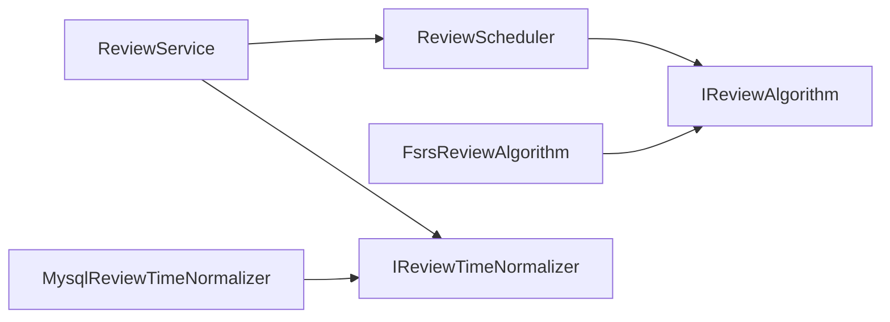

# #3 復習スケジューラ — 当日の解き直しとFSRS

## 今回の仕様

2026-11-13の依頼により、固定の2→4→7日と3回連続正解による定着判定をFSRSに置き換えます。
当日は、不正解・スルーした問題を正解できるまで繰り返します。
「当日の完了」と「長期的な定着推定」は別の値です。

| 目的             | 条件                                                                      |
| ---------------- | ------------------------------------------------------------------------- |
| 当日の問題完了   | 対象問題に正解したこと。不正解・スルーでは完了しない                      |
| 当日のセット完了 | 対象の全問に正解したこと                                                  |
| 定着推定         | 評価時点から30日後の想起確率が90%以上、かつFSRSが長期復習の状態であること |

30日という期間はユーザーが選択したアプリ側の基準です。FSRS自身が「完全習得」を保証するものではありません。
その日に全問正解しても、翌日以降はFSRSの期限に従って再び復習します。

## 実装した範囲と依存関係

2026-11-16にClean Architectureに沿って責務を分離しました。
ドメインには学習の意味とルールを置き、外部ライブラリ・JSON形式・DBの日時精度は外側で扱います。

| 層               | ファイル                                             | 責務                                           |
| ---------------- | ---------------------------------------------------- | ---------------------------------------------- |
| ドメイン         | `domains/UserQuizState/ReviewScheduler.ts`           | 解答による状態更新、30日後90%以上の定着判定    |
| ドメイン         | `domains/UserQuizState/IReviewAlgorithm.ts`          | 記憶状態・期限・想起確率の計算に必要な契約     |
| ドメイン         | `domains/UserQuizState/ReviewMemory.ts` / `index.ts` | 記憶状態と学習段階のアプリ内表現、再学習の要否 |
| アプリケーション | `applications/services/ReviewService.ts`             | 記録時刻を確定し、ドメインへ処理を渡す         |
| アプリケーション | `applications/shared/IReviewTimeNormalizer.ts`       | 保存可能な時刻へ揃える処理の契約               |
| インフラ         | `interfaces/infra/fsrs/FsrsReviewAlgorithm.ts`       | `ts-fsrs` を利用した上記計算の実装             |
| インフラ         | `interfaces/infra/fsrs/FsrsMemoryCodec.ts`           | FSRSの数値状態との変換、保存JSONの検証・変換   |
| インフラ         | `interfaces/infra/MysqlReviewTimeNormalizer.ts`      | MySQLの秒精度へ揃える具体的処理                |
| インフラ         | `interfaces/infra/UserQuizStateInfra.ts`             | 習熟状態のDB保存・復元                         |
| 組み立て         | `interfaces/factories/createReviewService.ts`        | 外側で具体的な実装を選び、サービスへ渡す       |

矢印はコードの依存方向です。FSRSアダプターは内側の契約を実装し、ドメインからアダプターをインポートしません。



`ReviewScheduler` はコンストラクターで `IReviewAlgorithm` の実装を受け取ります。
そのため、FSRSを動かさず、返す確率を指定した代替実装で定着判定だけを確認することもできます。
`Card` / `Rating` / `State`、FSRSの版番号、JSON、Zod、MySQLの精度はドメインへ持ち込みません。
日付計算用の共通dayjsは引き続き使用します。

通常の利用入口は `createReviewService()` が返すサービスです。
`service.scheduleReview(previous, judgement, reviewedAt)` と
`service.estimateRetention(previous, now)` を呼び出します。
ドメインの `ReviewScheduler` は時刻を丸めません。サービスが注入された日時変換を通してから呼び出します。

以前追加したPrismaマイグレーション、生成Kysely型、ライブラリの依存関係は維持しています。
今回の責務分離によるDBスキーマ変更はありません。
#3の範囲ではAPI・演習画面へ未接続です。実際の再出題、セット完了、中断・再開の挙動は後続で実装します。
DBへのマイグレーション適用や過去データの更新は行っていません。

## FSRSの設定と判定値

採用ライブラリは `ts-fsrs 5.4.2`、記憶モデルはFSRS-6です。
DockerのNode.js 22と互換性のある版に固定しています。ts-fsrs v6はNode.js 24以上が必要です。
バージョン番号はライブラリとFSRSモデルで異なります。

| iQbeの解答 | FSRSへの入力 | 当日の扱い         |
| ---------- | ------------ | ------------------ |
| `0` 不正解 | `Again`      | 再出題対象に残す   |
| `1` 正解   | `Good`       | その問題を完了する |
| `2` スルー | `Again`      | 再出題対象に残す   |

FSRSの数値とiQbeの判定値は異なるので、明示的に変換します。
`Hard` / `Easy` は現在の入力にないため使いません。検索用の `3=未解答` は拒否します。

- 目標保持率は90%。これは復習間隔の計算に使う設定であり、実際の正解率の保証ではありません。
- 学習・再学習のステップは1分を1段階だけ設定します。不正解・スルーは1分後に再学習し、その後1回正解すれば長期復習へ進みます。初回正解も長期復習へ進みます。
- 同日中や期限前の解答もFSRSに渡します。同じ日に正解したという理由で更新を省略しません。
- 初期のモデルの重みはライブラリ既定値を使用します。個人別の重みの最適化は未実装です。
- 復習間隔をランダムにずらす機能は無効にし、同じ状態・解答・時刻には同じ結果を返します。
- `scheduleReview` はDBにアクセスせず、入力を書き換えません。時刻は呼び出し元から渡します。
- 日付の検証・比較・計算・コピーには共通の `@/plugins/day` を使用します。30日後の計算はUTCで加算して1日24時間の意味を保ち、FSRS・DBとの受け渡し時に `Date` へ変換します。
- 保存時刻は `MysqlReviewTimeNormalizer` が既存の `DATETIME(0)` に合わせて秒へ切り捨てます。アプリケーション層から計算前に呼び出し、DB保存時にも同じ処理を使用します。DB接続のタイムゾーンは変更しません。

## モデルと保存

ドメインでは `UserQuizState.memory` に `ReviewMemory` を保持し、学習段階を
`learning` / `review` / `relearning` で表します。`needsRelearning` はこの意味に基づいて判断します。
計算方式の識別子は `profile` として持ちますが、ドメインはその文字列を解釈しません。

DBの `fsrs_memory` は従来どおりバージョン付きのJSONです。安定度、難易度、FSRS内部の学習段階、学習ステップ、忘却回数、経過日数を保持します。
JSONの `version`・数値 `state`・`learningSteps` はコーデックがドメインの `profile`・`phase`・`learningStep` へ対応付けます。既存JSONをそのまま読める形式を維持しています。
日時と回数は既存列を使用し、FSRSアダプターが計算時にFSRSのカードを組み立てます。復習候補の検索は既存の `next_review_at` インデックスを利用できます。
未学習の行は `next_review_at` が `NULL` なので、`next_review_at <= 現在時刻` の条件では候補に入りません。未学習の問題を出題するかどうかは、復習期限ではなく各機能（当日セット・スマート復習）が決めます。

- `reviewCount`: FSRSが処理した全解答数。初回と同日の解き直しも含みます。
- `successStreak`: 同日も含む連続正解数。参考値であり、定着判定には使いません。
- `intervalDays`: FSRSの予定日数。1分後の再学習では0です。正確な期限は `nextReviewAt` を使います。
- `lastReviewedAt`: 最後に処理した解答時刻。未学習（一度も解答していない）なら `null`。
- `nextReviewAt`: 次の復習期限。未学習なら `null`（期限なし）で、最初の解答から必ず値を持ちます。`lastReviewedAt` と `nextReviewAt` は両方 `null` か両方値ありのどちらかで、片方だけの状態は `UserQuizState` の生成時に `RangeError` になります。
  以前は未学習の行にも作成時刻などの仮の期限を入れていましたが、「期限が来た復習」と区別できないため `null` にしました。
- `needsRelearning`: FSRSが学習・再学習中かどうか。不正解・スルー後は `true`、正解後は `false` になります。未解答の新規問題はセット側の未完了情報で管理します。
- `state`: 最後の解答時点での `LEARNING` / `REVIEWING` / `RETAINED`。FSRS内部の状態とは別です。

`service.estimateRetention(state, now)` は、現在と30日後の想起確率、および定着推定の真偽を返します。
時間経過で確率が変わるため、成長画面の現在値はこの関数で再計算します。
DBの `state = RETAINED` の行数だけを数えると、過去の判定が残るため現在値になりません。

追加マイグレーションは次の 2 つです。

- `20261113000000_add_fsrs_memory`: `fsrs_memory` を追加します。既存行の情報は書き換えず、JSON列は `NULL` になります。
- `20261124000000_allow_null_review_due`: `next_review_at` を `NULL` 可にし、未学習の行（`last_reviewed_at IS NULL`）の仮の期限を `NULL` にそろえます。解答済みの行は変えません。

未学習状態だけをFSRSの新規カードとして初期化します。既に解答済みなのにFSRS情報がない状態は、推定値を捏造せずエラーにします。
そのような行は、解答APIがその組への最初の解答で履歴から作り直すか、移行スクリプト `learning:backfill --apply` で作り直します。手順は [packages/backend/LEARNING_RECORD_MIGRATION.md](../packages/backend/LEARNING_RECORD_MIGRATION.md) を参照してください。
`fsrs6-v1` は今回固定したライブラリ・重み・設定の組み合わせです。変更時はバージョンと移行方針を更新します。

## 後続のAPI・画面実装への引き継ぎ

#4では、再送の重複を除外してからFSRSへ渡し、解答履歴と状態を同じトランザクション内で保存します。
別端末の同時解答は直列化します。`ReviewService` が返した `lastReviewedAt` を解答履歴にも使用し、両者で同じ確定時刻を保存します。サービスとその依存先は外側で組み立て、ユースケースへ渡します。
初回正解・リベンジ等のイベント判定は、別途履歴を参照して行います。

#6・#7の当日セットは次の挙動にします。

1. 未解答の問題を順に出題する。
2. 不正解・スルーは未完了のまま再出題対象に残し、他の問題を挟んで、短期の期限到来後に再出題する。
3. 正解した問題は完了にし、未完了の問題が残っている間は再出題を続ける。残りが待機中なら、完了ではなく次の再出題までの待機を表示する。
4. 全問に正解したら、その日のセットを完了にする。完了数は解答回数ではなく正解済みの問題数を数える。
5. 中断できるようにし、未完了の問題をサーバーに残して別端末でも再開できるようにする。日付をまたいでも未完了の学習状態を消さない。

固定するのはセットの問題と初回出題順です。再出題の順序・進捗もサーバー側で管理します。
自由演習での正解によって当日セットを自動完了させず、対象セットへの解答であることをAPIで確認します。

## 最初に自分で書くテスト

対象: `packages/backend/src/interfaces/factories/createReviewService.test.ts`（新規作成）。
まずはDBを使わず、サービスとFSRSの連携を確認する課題です。
AGENTS.mdの学習方針に従い、テストコードは追加・変更していません。

最初の課題は「不正解の問題が、その日の解き直しで正解するまで残ること」です。

1. **準備**: `createReviewService()` でサービスを作ります。`2026-11-13T09:00:00+09:00` をdayjsで固定時刻として用意し、`UserQuizState.create(uid, qid)` で未学習状態を作ります（未学習なので期限は `null` で、時刻は受け取りません）。
2. **操作**: `service.scheduleReview` に未学習状態、判定 `0` と固定時刻を渡します。その返却値を次の入力にし、1分後に判定 `1` を渡します。
3. **確認**: 不正解直後は `needsRelearning === true`、次回は1分後、状態は `LEARNING` です。解き直して正解した後は `needsRelearning === false`、状態は `REVIEWING` となり、長期復習の期限を持ちます。初回の不正解を翌日に先送りしたり、その日の正解を無視したりする不具合を防ぎます。

ヒント: `Date` の比較には `toEqual` または `getTime()` 同士の比較を使えます。
必ず、最初の呼び出しの返却値を次の呼び出しへ渡します。実行日や待ち時間に依存するテストにしないようにします。

```bash
pnpm --filter backend test src/interfaces/factories/createReviewService.test.ts
```

次の課題候補は、スルーでの再学習、繰り返し不正解の維持、30日後90%の境界、時間経過での推定低下、保存・復元後の計算の一致、入力の不変性です。
ドメインの定着判定は `IReviewAlgorithm` の代替実装で確率を固定すると、ライブラリの重みに左右されずに確認できます。これらの新規動作と、責務分離前後の計算結果の一致はまだ動作テストで検証されていません。

## 検証結果（2026-11-16の責務分離）

- `pnpm typecheck`: 成功。バックエンドのビルドとフロントエンドの型検査を確認。
- `pnpm --filter backend test`: 122件成功、52件は通常実行の対象外。既存のAPI・ドメイン処理のテストは成功していますが、今回のFSRSロジックを直接検証するテストはまだありません。
- 変更したTypeScriptのOxlintと実装・本資料のOxfmt検査: 成功。
- 前回のFSRS導入時の `prisma generate` / `prisma validate`: 成功。ダミーの接続URLを使用し、実DBへ接続していません。
- 前回のFSRS導入時の `pnpm --filter backend test:integration`: 一時MySQLコンテナは起動できましたが、既存の準備処理にある `prisma db push --skip-generate` が現在のPrismaで拒否され、43件とも実行前に停止しました。今回変更していないテスト起動処理とPrismaの互換性の問題です。テストコードは変更していません。今回も同じ起動処理が残っており、再実行していません。

追加マイグレーションの実適用、FSRS情報のDB往復、新しい復習ルールの動作テストは未確認です。
既存の習熟状態スキーマテストは旧マイグレーションでテーブルを作り直すため、起動処理を直した後も新しいJSON列を検証するテストが別途必要です。

## 参照

- [ts-fsrs 5.4.2](https://www.npmjs.com/package/ts-fsrs/v/5.4.2): 採用バージョン。
- [FSRSのモデル説明](https://open-spaced-repetition.github.io/ts-fsrs/guide/model/): 安定度・難易度・想起確率。
- [FSRS-6の説明](https://open-spaced-repetition.github.io/ts-fsrs/guide/model/fsrs-6): 同日更新を含む記憶モデル。
- [ts-fsrsの公式リポジトリ](https://github.com/open-spaced-repetition/ts-fsrs): 最新版と実行環境の要件。
